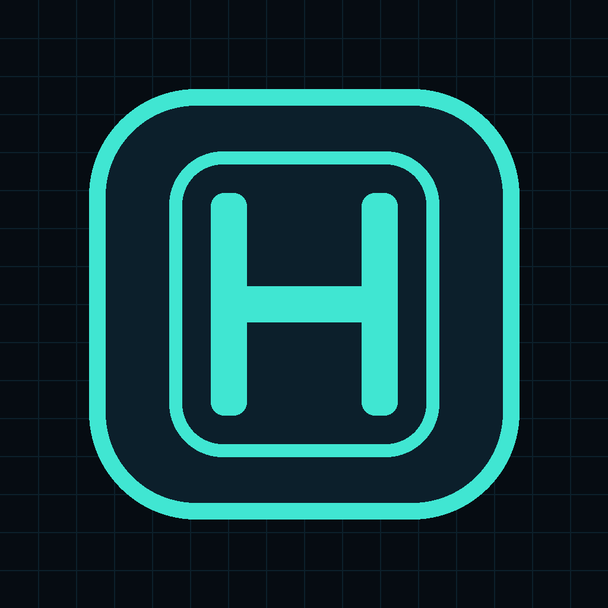
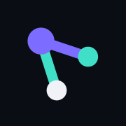
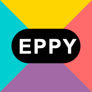
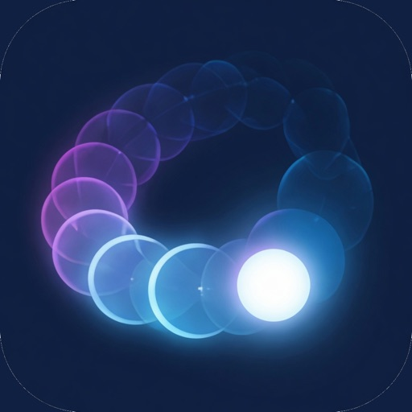

# Sergii Ziborov 👋

### 🔐 Full-stack product engineer at [EdgeHawk](https://edgehawk.io/) · cybersecurity, AI coding systems & developer infrastructure

> Making AI coding agents understand the systems they change — and giving humans evidence and control over what happens next.

At [EdgeHawk](https://edgehawk.io/), I work across the frontend, controller REST API, analytics, and operator documentation of a carrier-grade DDoS defense platform for large telecom and service-provider networks. That platform is what Cisco ships as [Secure DDoS Edge Protection](https://www.cisco.com/site/us/en/products/security/ddos-edge-protection/index.html).

Outside work I build evidence infrastructure for AI agents, exact open-model inference, origin-side protection for servers I can actually see, MCP servers, and the products that sit on top of them. TypeScript is my delivery stack; Rust is where the engines live — scanners, graphs, parsers, protocol stacks, collectors, codecs, and inference.

---

## 🛡️ Current work

  <a href="https://edgehawk.io/">
    <picture>
      <source media="(prefers-color-scheme: dark)" srcset="https://raw.githubusercontent.com/sergii-ziborov/sergii-ziborov/main/assets/edgehawk-logo-dark.png">
      
    </picture>
  </a>

**Full-stack product engineer** working across the **frontend, controller REST API, analytics, edge-analytics, and the Cisco operator documentation**.

[EdgeHawk](https://edgehawk.io/) builds a distributed, cloud-native cyber-defense overlay for CSP and telecom networks. A containerized controller manages detectors deployed on peering, mobile-access, and broadband routers. Each detector runs in spare CPU and memory on the router, analyzes flow telemetry close to the traffic source, and can push ingress mitigation back onto that router — ACL, and where the deployment uses them, FlowSpec, RTBH, and reroute — so attack traffic does not have to be hauled to a scrubbing center.

The same software is [Cisco Secure DDoS Edge Protection](https://www.cisco.com/site/us/en/products/security/ddos-edge-protection/index.html): detectors packaged for Cisco IOS XR, and a controller that shares protective state across the network. My work is the operational surface around that loop — security configuration, platform health, real-time attack visibility, event analytics, mitigation orchestration — and the operator documentation published for the Cisco solution.

[EdgeHawk →](https://edgehawk.io/) · [Cisco Secure DDoS Edge Protection →](https://www.cisco.com/site/us/en/products/security/ddos-edge-protection/index.html) · [GitHub organization →](https://github.com/edgehawk)

---

## Hostwatch — evidence and control for servers you own

 [gethostwatch.com](https://gethostwatch.com) · [protection](https://gethostwatch.com/protection/) · [compute](https://gethostwatch.com/compute/) · [MCP](https://gethostwatch.com/mcp)

**See the pressure. Know the cause. Control the response.** A Go agent on your own server records host health, workloads, services, and HTTP evidence. Hostwatch Cloud, or a privately installed control plane, coordinates what you permit. It stays outside the request path: traffic still arrives through the network and the edge provider you already chose.

Protection is scoped to what the evidence can support.

- **Scanners and discovery** — sensitive-path probes, URL enumeration, exploit-endpoint discovery. With Nginx configured, a client limit or deny is previewed before it goes live, then attributed and set to expire.
- **HTTP route pressure** — distributed URL floods and expensive routes, read against coverage and measured harm. A high request count alone is not an attack.
- **Host pressure** — SYN, UDP, and ICMP counters from the Linux agent. These are node-wide signals, not a packet-level attacker list, and they do not install a packet filter by themselves.
- **A saturated uplink** stays an upstream problem. Hostwatch does not sell CDN, Anycast, or volumetric scrubbing.

The same account lends machines to a [compute network](https://gethostwatch.com/compute/). [Hetero](#hetero) spreads a model's layers across the memory they offer — a Mac GPU through Metal, a graphics card through Vulkan or DX12, or plain RAM — and the answer stays the model's own greedy decoding. Clients still see one OpenAI- or Ollama-compatible endpoint.

The workspace follows you on the web, iPhone, and iPad, and through an authorized MCP assistant. A 7-day trial covers the first server. Private Enterprise is the full control plane under an installation license, with no separate cloud subscription.

---

## Weavatrix — evidence infrastructure for AI software agents

 [weavatrix.com](https://weavatrix.com) · [organization](https://github.com/Weavatrix) · [ecosystem map](https://weavatrix.com/ecosystem) · [npm](https://www.npmjs.com/package/weavatrix)

**Build agents that understand before they act.** Weavatrix turns source, configuration, Git history, and architecture rules into durable evidence that agents can query, verify, remember — and change only through a separate, guarded boundary. Installing one boundary never silently grants another.

| Boundary | Surface |
| --- | --- |
| [**Core**](https://github.com/Weavatrix/weavatrix) | 43 read-only repository-intelligence tools — orientation, impact, APIs, architecture, Git, search, semantics, memory |
| [**Refactor**](https://github.com/Weavatrix/weavatrix-refactor) | 11 tools for exact previews, byte-bound confirmation, crash-recoverable apply, and drift-checked rollback |
| [**Online**](https://github.com/Weavatrix/weavatrix-online) | 7 explicit network tools — endpoint status, advisories, malware review, architecture contracts, source-free sync |
| [**Quality**](https://github.com/Weavatrix/weavatrix-quality) | Revision-bound obligations, runner evidence, immutable proofs, and honest incomplete-evidence states |

Underneath sit independently released Rust engines, each with its own API, license and reproducible measurements: [graph](https://github.com/Weavatrix/weavatrix-graph) · [parse](https://github.com/Weavatrix/weavatrix-parse) · [scan](https://github.com/Weavatrix/weavatrix-scan) · [search](https://github.com/Weavatrix/weavatrix-search) · [vector search](https://github.com/Weavatrix/weavatrix-search-vector) · [semantic](https://github.com/Weavatrix/weavatrix-semantic) · [memory](https://github.com/Weavatrix/weavatrix-memory) · [git](https://github.com/Weavatrix/weavatrix-git) · [clone](https://github.com/Weavatrix/weavatrix-clone) · [edit](https://github.com/Weavatrix/weavatrix-edit) · [worktree](https://github.com/Weavatrix/weavatrix-worktree) · [lsp](https://github.com/Weavatrix/weavatrix-lsp) · [rust engine](https://github.com/Weavatrix/weavatrix-rust) · [benchmarks](https://github.com/Weavatrix/weavatrix-benchmarks)

And on top of them:

- 🧵 [**Weavatrix Loom**](https://github.com/Weavatrix/weavatrix-loom) + [**Loom Studio**](https://github.com/sergii-ziborov/loom-studio) — compose systems from verified capabilities as typed graphs, then compile ordinary standalone Rust.
- 🧹 [**SweepLoom**](https://github.com/Weavatrix/sweeploom) — local-first workstation resource manager: disk, projects, terminals, AI agent sessions, browser. Deterministic and inspectable; no LLM in the destructive path.
- 🔎 [**Weavatrix SEO**](https://github.com/Weavatrix/weavatrix-seo) — source-aware search intelligence: audit the site you shipped against the code that actually produced it.

### 🧬 Hetero — exact inference, on every processor and across machines

*Private research.* [Hostwatch compute](https://gethostwatch.com/compute/) is the public door.

Hetero runs open models so every token is the model's own greedy decoding: bit for bit what one process would compute. Drafts and lookups only propose. A verify pass checks them. Lower precision stays off the default path when it fails that contract.

| Engine | Where it runs |
| --- | --- |
| Metal | A Mac GPU — F16 weights, GQA decode attention, every draft kind |
| WebGPU | A graphics card through Vulkan or DX12, or Apple's GPU, in WGSL |
| CPU | Portable kernels whose bits do not depend on the machine or the thread count |
| Stages | Other machines, through Hostwatch: pipeline layers or a share of every layer |

`hetero serve` speaks OpenAI's API and Ollama's, including tools and streaming, so existing clients do not change. A model that fits in no single machine is split by measured memory first and speed second. On the published benches, Qwen3-4B (7.3 GiB of layers) ran across two Linux machines of 4.5 GiB that each refused it alone, with logits bit-identical to one process. The same prompt produced the same text on Metal, WebGPU, Vulkan, and CPUs.

Speech uses the same contract. A Whisper server over a product's own whisper.cpp is faster per request than that product's default mode, with byte-identical output, and [Tellwick](https://tellwick.com) Notes runs Whisper large-v3-turbo live on it: audio in, speech boundaries, partials and finals. An optional local vision backend (Qwen3-VL through llama.cpp) can sit beside the text engines. It is labeled as a separate backend. The exactness claims do not transfer to it.

Results graduate into public product claims only when their exact evidence and limits are reproducible.

---

## GrantTap — live control for local coding agents

 [granttap.com](https://granttap.com) · [npm](https://www.npmjs.com/package/granttap-mcp) · [MCP bridge](https://github.com/sergii-ziborov/granttap-mcp) · [relay](https://github.com/sergii-ziborov/granttap-relay) · [terminal](https://github.com/sergii-ziborov/granttap-term)

**See · decide · continue.** A native command center for the coding agents running on your own computers — Claude Code, Codex, Cursor, and Grok Build — on Mac, iPhone, iPad, and Apple Watch. Prompts and credentials never leave the machine in the clear. The relay routes ciphertext.

- **See** — the agent, model, computer, workspace, task timeline, tool and skill usage, failures, and context pressure, across several computers at once.
- **Decide** — approvals, questions, and failed deliveries surface in Needs You. Technical questions can stay agent-to-agent. Product, security, destructive actions, and unresolved conflicts reach a person. The watch is a glance, a decision, a short reply, or a new voice task.
- **Continue** — the next turn by voice, photo, or file, on the same local session.
- **Mesh** — one project scope for repositories, people, computers, and rules. A Task keeps one goal when a different agent or computer continues it. Governance allows, asks, or denies skills, MCP servers, and shell. Auto-accept runs only after the effective policy permits the call. Roles say why a refusal happened, and a refusal never reaches the computer.
- **[GrantTap Term](https://github.com/sergii-ziborov/granttap-term)** — the desk inside a terminal you already have open, including SSH. Chats for Grok, Claude, and Codex, a task queue, the repository mesh, files, a text browser, and lessons. `granttap-term mcp` is the offline **granttap-local** server: stdio only, no HTTP, no OAuth. It does not replace the phone or the relay.

The MCP bridge, approval hooks, relay, and terminal desk are open source. The Mac, iOS, iPadOS, and watchOS apps are not. Mac, iPhone, and iPad are available by invitation while the first commercial release is prepared.

---

## 🚀 Products

EdgeHawk, Hostwatch, Weavatrix, Hetero, and GrantTap are the systems above. What follows is everything else that is public, read in the order a visitor needs: products people use, the App Store catalog, then smaller tools.

| | Product | What it is |
| --- | --- | --- |
|  | [**ApplyDjin**](https://applydjinn.com/) | Live hiring intelligence — technologies, stacks, vacancies, companies, salaries — with requirement evidence split into core, required, context, and nice-to-have. Matching names the skill that actually unlocks more roles. CVs, cover letters, portfolios, and recruiter notes are drafted from that evidence by a model and stay editable until a person approves them. [iPhone app](https://apps.apple.com/us/app/applydjinn/id6820561847) |
|  | [**Tellwick**](https://tellwick.com) | Multilingual AI copilot with native speech and diarization, translation, notes, calendar workflows, and structured exports. Live notes run Whisper large-v3-turbo on Hetero |
|  | [**Kablay IL**](https://kablay.co.il/en) | Multilingual marketplace connecting people in Israel with verified home-repair and renovation professionals. [iPhone and iPad](https://apps.apple.com/us/app/kablay-il/id6809115380) |
|  | [**Kablay US**](https://kablay.us) | Verified home-service marketplace for Southwest Washington — Clark County, WA |
|  | [**EPPY**](https://eppy.co.il/en/) | Multilingual service and commerce platform for Apple and Android repairs in Israel |

### On the App Store

The public developer page, [Serhii Ziborov](https://apps.apple.com/us/developer/serhii-ziborov/id6809115382), currently lists these five. ApplyDjin and Kablay IL are described above. The other three are the on-device compilers and the game.

| | App | What it is |
| --- | --- | --- |
|  | [**Crabrix**](https://apps.apple.com/us/app/crabrix-rust-compiler/id6809502653) | Rust on iPhone and iPad. The compiler ships in the app, with an offline academy and a local project workspace. [crabrix.com](https://crabrix.com) |
|  | [**GopherForge**](https://apps.apple.com/us/app/gopherforge-go-compiler/id6809702319) | Go on iPhone and iPad: an on-device compiler, debugger, tests, and a learning library. [gopherforge.app](https://gopherforge.app) |
|  | [**ECHO**](https://apps.apple.com/us/app/echo-survive-your-past/id6811673094) | A science-fiction route puzzle for iPhone, iPad, and Apple Watch. The path you take comes back as the hazard |

### Smaller tools

[**RadioChron**](https://radiochron.com) is the pure-Rust Wi-Fi and BLE diagnostics stack: typed verdicts, native collectors, and an MCP server. [**BranchPilot**](https://github.com/sergii-ziborov/BranchPilot) is the local desktop Git client. Its home is that repository.

The models are not a side folder. Hetero is the inference runtime. Hostwatch is how a model spans machines you own. Tellwick, ApplyDjin, and the film stack call models at the point of the product: live speech, reviewed application documents, and vision. GrantTap is the control surface for the agents and the host model they are allowed to use.

---

## ⚙️ Open-source engines

### ⚡ Blazingly — a Tokio-free Rust API framework

One typed contract for HTTP, MCP, OpenAPI, and AI agents. Every adapter implements its wire protocol directly, with no async runtime underneath.

[framework](https://github.com/sergii-ziborov/blazingly) · [wire](https://github.com/sergii-ziborov/blazingly-wire) · [contract](https://github.com/sergii-ziborov/blazingly-contract) · [json](https://github.com/sergii-ziborov/blazingly-json) · [postgres](https://github.com/sergii-ziborov/blazingly-postgres) · [sqlite](https://github.com/sergii-ziborov/blazingly-sqlite) · [redis](https://github.com/sergii-ziborov/blazingly-redis) · [nats](https://github.com/sergii-ziborov/blazingly-nats) · [esp-idf](https://github.com/sergii-ziborov/blazingly-esp-idf) · [examples](https://github.com/sergii-ziborov/blazingly-examples) · [equivalence benchmark](https://github.com/sergii-ziborov/blazingly-api-bench)

Plus [**mcport**](https://github.com/sergii-ziborov/mcport) — a Tokio-free MCP stdio runtime for Rust.

### 🎬 ReelForge & SightLoom — programmatic video and vision

Video composition as a fluent clip graph, driven by automation and agents rather than a GUI. [SightLoom](https://github.com/sergii-ziborov/SightLoom) turns detections into tracks, identities, events, and queryable video memory. The index stays model-neutral. Host adapters run ONNX detectors and re-identification embeddings — YOLOv8 and a person re-id network among them — and keep the evidence pack next to the decision. The render graph stays deterministic.

[ReelForge](https://github.com/sergii-ziborov/ReelForge) · [Host](https://github.com/sergii-ziborov/ReelForge-Host) · [Capture](https://github.com/sergii-ziborov/ReelForge-Capture) · [Studio](https://github.com/sergii-ziborov/ReelForge-Studio) · [Intelligence](https://github.com/sergii-ziborov/ReelForge-Intelligence) · [SightLoom](https://github.com/sergii-ziborov/SightLoom)

### 🕊️ Reedhold & Blindplane — a social mesh that keeps holding

A protocol for a social network that survives its creator: recoverable cryptographic identity, signed events, bounded clients, and state that does not live on a company server — over a data plane whose relays route, store, and index records they cannot read.

[Reedhold protocol](https://github.com/sergii-ziborov/reedhold) · [host](https://github.com/sergii-ziborov/reedhold-host) · [desktop](https://github.com/sergii-ziborov/reedhold-app) · [iOS / macOS](https://github.com/sergii-ziborov/reedhold-swift) · [Blindplane](https://github.com/sergii-ziborov/blindplane)

### 🧲 FerroSift — deterministic, local-first data transformation

A pure-Rust recipe engine that runs natively and on `wasm32`, with no JavaScript runtime. Precision over breadth: **198 operations, 192 byte-pinned against pinned CyberChef v11.3/v11.4 checkouts across 3,628 corpus cases** — regenerated and gated in CI, never asserted by hand.

[**ferrosift** →](https://github.com/sergii-ziborov/ferrosift)

### 🧠 Cortex Loom — a verifiable context compiler for coding agents

Compiles a task-complete, revision-bound evidence packet and proves which required facts are present, missing, contradictory, or stale. It gives the model only the facts it needs — and does not hide the unknown.

[**cortex-loom** →](https://github.com/sergii-ziborov/cortex-loom)

---

## 🛠 Tech Stack

**Languages**

  
  
  
  
  
  
  

**AI & coding agents**

  
  
  
  
  
  
  
  

**Application & platform**

  
  
  
  
  
  
  

**Data & infrastructure**

  
  
  
  
  
  
  
  
  
  

**Security & systems**

  
  
  
  
  
  
  
  

---

## 🤖 What I'm Doing

- **Making AI coding agents understand code** — deterministic graphs, scanners, repository intelligence, change impact, and evidence they can reason over.
- **Running models exactly** — Metal, WebGPU, and portable CPU inference whose tokens match the model's own greedy decode, including models split across machines through Hostwatch.
- **Building an MCP ecosystem** — servers across code intelligence, refactoring, radio diagnostics, server operations, approvals, context compilation, and mesh identity, on top of a Tokio-free Rust MCP runtime.
- **Separating knowing from doing** — read-only evidence, guarded write boundaries, byte-bound previews, and rollback, so an agent never gets a capability it was not explicitly granted.
- **Engineering network-edge security** — [EdgeHawk](https://edgehawk.io/) and [Cisco Secure DDoS Edge Protection](https://www.cisco.com/site/us/en/products/security/ddos-edge-protection/index.html) on the carrier side, [Hostwatch](https://gethostwatch.com/protection/) on the origin: evidence first, a scoped action second, and an honest line where upstream volumetric defense still has to do the work.
- **Publishing measurements, not adjectives** — parity checks, fixtures, caveats, and reproduction commands, including the rows where someone else wins.

---

## 📬 Connect

- 💼 **LinkedIn:** [in/ziborov](https://www.linkedin.com/in/ziborov)
- 📧 **Email:** [sergii.ziborov@gmail.com](mailto:sergii.ziborov@gmail.com)
- 🌐 **Website:** [weavatrix.com](https://weavatrix.com)

---

## 💡 Random Facts

- ☕ Coffee is part of the build system.
- I build tools for coding agents, then use coding agents to improve them.
- One idea tends to become a whole stack: a native core, an MCP server, a desktop app, and a site.
- I will benchmark a scanner against `ripgrep` just to find where the real bottleneck is — and publish the platform where `ripgrep` still wins.
